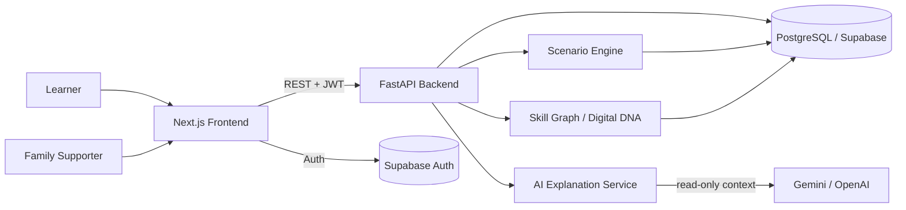

# HIMMAT — Digital Life Simulator
## System Architecture

**Version:** 1.0 | **Date:** 31 Oct 2026

> **Core architectural rule:** The scenario engine is **deterministic** and is the **only source of truth** for what happens in a simulation. AI is an **explanation layer** (hints, simplification, language), never the decider.

---

## 1. Overview

HIMMAT is a web application where learners practise realistic digital situations in a fully simulated environment.

```
Learner / Family → Next.js Frontend → FastAPI Backend
                                        ├─ Scenario Engine (state machines)
                                        ├─ Consequence + Recovery Engine
                                        ├─ Replay / What-if (branching)
                                        ├─ Skill Graph / Digital DNA / Spaced repetition
                                        ├─ AI Explanation Service (Gemini/OpenAI, read-only)
                                        └─ PostgreSQL (Supabase) + Supabase Auth
```

---

## 2. Architectural Principles

1. **Deterministic core.** Same state + same action ⇒ same result. Fully explainable and testable.
2. **AI as explainer, not oracle.** AI never changes state, never invents outcomes. Static hints always exist as fallback.
3. **Data-driven scenarios.** New scenario = new JSON file (+ optional UI component).
4. **Event-sourced sessions.** Every step is an append-only event, which gives replay and what-if for free.
5. **Safety by design.** No real credentials/OTP/ID/payment; fictional brands; input validators.
6. **Privacy by default.** Consent-based family sharing; row-level security; PII-free AI prompts.
7. **Accessibility first.** Large text, high contrast, read-aloud, RTL, calm tone.
8. **Graceful degradation.** Works without AI; works if a locale is incomplete (fallback to English).

---

## 3. System Context Diagram



---

## 4. Technology Stack (complete)

### 4.1 Frontend
| Concern | Choice | Why |
|---|---|---|
| Framework | **Next.js 14/15 (App Router) + TypeScript** | Routing, SSR/SSG, great DX, Vercel deploy |
| Styling | **Tailwind CSS** | Fast, consistent, easy large-text/contrast themes |
| Components | **shadcn/ui** (Radix primitives) | Accessible, customizable components |
| Animation | **Framer Motion** | Smooth consequence transitions, replay timeline |
| Charts | **Recharts** | Radar/bar/line for Digital DNA and dashboard |
| Client state | **Zustand** | Lightweight simulator/session state |
| Server state | **TanStack React Query** | Caching, retries, optimistic updates |
| Forms/validation | **React Hook Form + Zod** | Typed validation, input sanitizers |
| i18n | **next-intl** | en / ur (RTL) / ur-Latn (Roman Urdu) |
| Icons | **lucide-react** | Consistent icon set |
| Fonts | **Inter / Noto Nastaliq Urdu (or Noto Naskh Arabic)** | Latin + Urdu readability |
| TTS | **Web Speech API** | Read-aloud, no server cost |
| Auth client | **@supabase/supabase-js** | Session handling |
| Testing | **Vitest + React Testing Library, Playwright** | Unit/component + E2E |
| Lint/format | **ESLint + Prettier** | Quality gate |

### 4.2 Backend
| Concern | Choice | Why |
|---|---|---|
| Framework | **FastAPI (Python 3.11+)** | Async, typed, auto OpenAPI |
| Validation | **Pydantic v2** | Typed schemas |
| ORM / migrations | **SQLAlchemy 2.x + Alembic** | Mature, async support |
| Scenario engine | **Python + JSON state machines** | Deterministic, auditable |
| Scenario validation | **jsonschema** | Schema + graph checks |
| Auth verification | **PyJWT / python-jose** verifying Supabase JWT | Stateless auth |
| AI SDK | **google-generativeai** or **openai** | Explanation layer |
| HTTP client | **httpx** | Async calls |
| Rate limiting | **slowapi** | Protect AI/auth endpoints |
| Scheduling | **APScheduler** (or Supabase cron) | Review reminders (P2) |
| Testing | **Pytest + pytest-asyncio + httpx TestClient** | Engine and API tests |
| Lint/format | **Ruff + Black + mypy** | Quality gate |
| Server | **Uvicorn (+ Gunicorn in prod)** | ASGI |

### 4.3 Data and Platform
| Concern | Choice |
|---|---|
| Database | **PostgreSQL 15+ via Supabase** |
| Auth | **Supabase Auth** (JWT, RLS) |
| Storage | Supabase Storage (static assets, optional) |
| Containers | **Docker + docker-compose** (local dev) |
| CI/CD | **GitHub Actions** |
| Frontend hosting | **Vercel** |
| Backend hosting | **Render** |
| Monitoring | Sentry (errors), Render/Vercel logs; Plausible/PostHog optional |

---

## 5. Component Architecture

### 5.1 Frontend modules
- **Simulator**: `PhoneFrame`, simulated apps (`ChatLineApp`, `SafeTrustBankApp`, `PaySathiApp`, `BazaarNowApp`, `MeetKaroApp`, `ESahulatApp`), `ScenarioPlayer` (renders node UI from engine response).
- **Consequence panel**: What happened / Why / Should have / Do differently.
- **Replay**: `ReplayTimeline`, `WhatIfPicker`, `OutcomeComparison`.
- **Recovery Lab**: step-sequence UI, order/completeness feedback.
- **Digital DNA**: `SkillRadar`, `SkillTrend`, `RecommendationCard`.
- **Mentor**: hint drawer (3 levels), ask-box (text; voice future), language-aware.
- **Family**: consent manager, supporter dashboard.
- **Shared**: i18n provider, accessibility provider (text size/contrast/TTS), "Practice world" banner.

### 5.2 Backend modules
- **api/** — routers (thin; validation + auth + call services).
- **engine/** — loader, state machine, consequence builder, replay builder, branching, recovery evaluator, validators.
- **skills/** — taxonomy, evidence→mastery updater, decay, recommender, spaced repetition.
- **ai/** — provider client, prompt templates, guardrails, redaction, static-hint fallback.
- **services/** — orchestration (session service, family service, assessment service).
- **db/** — models, session factory, migrations.
- **scenarios/** — JSON files + schema.

---

## 6. Scenario Engine Design

### 6.1 Concepts
- **Node types:** `screen` (UI shown), `decision` (choices emphasized), `outcome` (terminal with consequence), `recovery_step`.
- **State:** typed key-value map (booleans, ints, enums) per session.
- **Action:** `{id, label_key, guard?, effects, evidence[], next}`.
- **Guard:** optional condition on state (e.g., show "Call bank" only if `bank_number_known`).
- **Effects:** `set`, `inc`, `append` operations applied atomically.
- **Evidence:** `{skill, value 0..1, weight}` emitted for skill model.
- **Outcome rules:** evaluated in priority order against final state → consequence + optional recovery link.

### 6.2 Execution algorithm (pseudo)
```python
def apply_action(session, action_id):
    node = scenario.nodes[session.current_node]
    action = node.actions[action_id]                  # 400 if missing
    assert guard_ok(action.guard, session.state)      # 409 if guard fails
    before = deepcopy(session.state)
    session.state = apply_effects(session.state, action.effects)
    session.current_node = action.next
    consequence = build_consequence(scenario, node, action, before, session.state)
    event = append_event(session, node.id, action.id, before, session.state,
                         hints_used=session.hints_used_at_node, consequence=consequence)
    emit_skill_evidence(session, action.evidence, hints_used=event.hints_used)
    if is_terminal(session.current_node): finalize(session)   # outcome rules
    return {"next_node": render(session.current_node), "consequence": consequence}
```

### 6.3 Determinism guarantees
- No randomness in transitions. Variants are chosen **at session start** (seeded), stored in the session, and used for text/parameters only.
- Pure functions for effects/guards/outcomes; unit-tested with property tests.

### 6.4 Variants
`variants: [{id, params: {sender, amount, bank_name, urgency_text}}]` swapped into locale templates (`{{sender}}`). Used by Mastery Test and spaced repetition to test the same skill with a different surface.

### 6.5 Scenario validation (build-time CLI)
`python -m app.engine.validators` checks: schema validity, all `next` targets exist, no unreachable nodes, every path reaches an outcome, every `*_key` exists in all required locales, hints present for every decision node, recovery references valid.

### 6.6 Example scenario (Fake Bank Message — abridged)
```json
{
  "id": "fake_bank_message",
  "skills": ["scam_detection", "otp_safety", "reporting"],
  "initial_node": "n_msg",
  "initial_state": {"sender_checked": false, "link_clicked": false, "otp_shared": false, "reported": false, "risk": 0},
  "nodes": {
    "n_msg":    {"type": "screen", "ui": {"component": "ChatThread", "props": {"messageKey": "msg.urgent_bank"}},
                 "actions": [
                   {"id": "inspect", "next": "n_sender", "effects": {"set": {"sender_checked": true}}, "evidence": [{"skill":"scam_detection","value":1,"weight":0.6}]},
                   {"id": "open_link", "next": "n_fake_page", "effects": {"set": {"link_clicked": true}, "inc": {"risk": 2}}, "evidence": [{"skill":"scam_detection","value":0,"weight":0.8}]},
                   {"id": "call_son", "next": "n_helped", "effects": {}, "evidence": [{"skill":"scam_detection","value":0.3,"weight":0.3}]}
                 ],
                 "hints": ["hint.l1.msg", "hint.l2.msg", "hint.l3.msg"]},
    "n_sender": {"type": "screen", "ui": {"component": "SenderDetails"}, "actions": [
                   {"id": "report_block", "next": "n_safe", "effects": {"set": {"reported": true}}, "evidence": [{"skill":"reporting","value":1,"weight":0.7}]}]},
    "n_fake_page": {"type": "screen", "ui": {"component": "FakeVerifyPage"}, "actions": [
                   {"id": "enter_otp", "next": "n_compromised", "effects": {"set": {"otp_shared": true}, "inc": {"risk": 5}}, "evidence": [{"skill":"otp_safety","value":0,"weight":1.0}]},
                   {"id": "close_page", "next": "n_close_call", "effects": {}, "evidence": [{"skill":"otp_safety","value":0.8,"weight":0.7}]}]}
  },
  "outcomes": {
    "n_safe": {"type":"outcome","consequence_key":"cons.safe"},
    "n_compromised": {"type":"outcome","consequence_key":"cons.compromised","recovery":"recovery_shared_otp"},
    "n_close_call": {"type":"outcome","consequence_key":"cons.close_call"}
  }
}
```

---

## 7. Mistake Replay and What-if Engine

### 7.1 Event sourcing
`session_events` is append-only: `(session_id, step_no, node_id, action_id, state_before, state_after, hints_used, consequence_key, ts)`.

### 7.2 Replay generation
`build_replay(session_id)` maps each event to a **plain-language step** via locale template `replay.<scenario>.<node>.<action>` and classifies it `safe | risky | neutral` from the evidence value and state delta.

### 7.3 What-if branching
```
POST /sessions/{id}/branch  { "from_step": 2, "action_id": "inspect" }
```
1. Load parent events up to `from_step - 1` → reconstruct state **before** step.
2. Create new session: `parent_session_id`, `branch_from_step`, state = reconstructed state, `current_node = node_at_step`.
3. Apply chosen action via the normal engine path.
4. Parent session is never modified.

### 7.4 Comparison
`GET /sessions/{id}/compare/{branch_id}` returns aligned timelines (shared prefix, then divergence) with outcome summaries: final state diff, consequences, skill-evidence delta. Frontend renders side-by-side.

---

## 8. Recovery Lab

- Recovery scenario JSON defines `required_steps` (with optional `order_constraints`/DAG), `optional_steps`, `harmful_steps`.
- Evaluator returns: completeness %, order violations, missed critical steps, explanation keys.
- Example `recovery_shared_otp`: (1) stop interacting → (2) call bank via official number → (3) block card / reset PIN → (4) change related passwords → (5) report & monitor. Order constraint: contact bank before reporting elsewhere.
- Linked from consequence screens whose outcome carries `recovery`.

---

## 9. Skill Graph, Digital DNA, Mastery, Reinforcement

### 9.1 Mastery update (per skill)
For each evidence item `e = {value v, weight w}` and hint penalty `h` (0, 0.15, 0.3 for hints level 1–3 used):
```
v_eff   = max(0, v - h)
alpha   = base_alpha * w                 # base_alpha ≈ 0.35
mastery = mastery + alpha * (v_eff*100 - mastery)
```
Mastery Tests (unaided) use `base_alpha = 0.5` and count toward the "retained" score.

### 9.2 Decay (retention)
```
effective_mastery = mastery * exp(-days_since_practice / S)   # S = stability, grows with successful reviews
```
Stability `S` starts ≈ 7 days; multiplies by ≈ 1.8 after each successful unaided review; resets lower after a failure.

### 9.3 Recommendation
`score(skill) = (100 - effective_mastery) * importance + staleness_bonus`; pick the top skill, then the least-recently-seen scenario/variant covering it.

### 9.4 Spaced repetition (P2)
Schedule at 1, 3, 7, 14 days (adaptive from stability). `review_schedule` table; dashboard "Due today" card; different variant each time.

### 9.5 Confidence tracking
1–5 self-rating before/after each scenario; stored separately from mastery so we can show **skill vs confidence** (the research gap).

---

## 10. AI Layer

### 10.1 Role
- Progressive hints, plain-language explanations, translation/simplification, "explain your decision" dialogue.
- **Never**: choose outcomes, change state, reveal hidden future branches at hint levels 1–2, or ask for real personal data.

### 10.2 Request pipeline
```
Client → POST /mentor/hint {session_id, level}
   → load node + visible UI text + learner-visible state (read-only)
   → build prompt (system rules + context + language + level)
   → redact (strip digits ≥ 6, emails, phone numbers)
   → call provider (timeout 6s, 1 retry)
   → guardrail check (length, language, banned patterns, no instructions to share real data)
   → return hint | on failure → static hint from node.hints[level]
```

### 10.3 Prompt contract (system prompt summary)
- You are a gentle helper in a *practice world*; speak simply in {language}.
- You may explain and hint; you may not do the task for the user.
- Level 1: nudge a question; Level 2: point to the relevant UI element; Level 3: explain the reason, still don't click for them.
- Never ask for real passwords, OTPs, card or ID numbers.
- Output ≤ 3 short sentences.

### 10.4 Caching and cost control
Cache key `(scenario_id, node_id, level, language, variant)` for hints; per-user rate limit; static hints seeded for all nodes.

---

## 11. Data Model (PostgreSQL)

```sql
-- Users come from Supabase auth.users; profiles extends them
create table profiles (
  id uuid primary key references auth.users(id) on delete cascade,
  display_name text,
  role text check (role in ('learner','supporter','admin')) default 'learner',
  created_at timestamptz default now()
);

create table learner_settings (
  user_id uuid primary key references profiles(id) on delete cascade,
  language text check (language in ('en','ur','ur-Latn')) default 'en',
  text_size text check (text_size in ('normal','large','xlarge')) default 'large',
  high_contrast boolean default false,
  read_aloud boolean default false
);

create table scenarios (
  id text primary key,                -- e.g. 'fake_bank_message'
  version int not null,
  title_key text not null,
  skills text[] not null,
  difficulty int default 1,
  is_active boolean default true
);

create table sessions (
  id uuid primary key default gen_random_uuid(),
  user_id uuid not null references profiles(id) on delete cascade,
  scenario_id text not null references scenarios(id),
  variant_id text,
  mode text check (mode in ('practice','mastery','recovery','assessment','review')) default 'practice',
  parent_session_id uuid references sessions(id),
  branch_from_step int,
  current_node text not null,
  state jsonb not null,
  status text check (status in ('active','completed','abandoned')) default 'active',
  outcome_key text,
  started_at timestamptz default now(),
  completed_at timestamptz
);

create table session_events (
  id bigserial primary key,
  session_id uuid not null references sessions(id) on delete cascade,
  step_no int not null,
  node_id text not null,
  action_id text not null,
  state_before jsonb not null,
  state_after jsonb not null,
  hints_used int default 0,
  consequence_key text,
  created_at timestamptz default now(),
  unique (session_id, step_no)
);

create table skills (
  id text primary key,
  name_key text not null,
  importance real default 1.0
);

create table skill_scores (
  user_id uuid references profiles(id) on delete cascade,
  skill_id text references skills(id),
  mastery real not null default 0,
  stability_days real not null default 7,
  last_practiced_at timestamptz,
  primary key (user_id, skill_id)
);

create table skill_evidence (
  id bigserial primary key,
  user_id uuid references profiles(id) on delete cascade,
  skill_id text references skills(id),
  session_id uuid references sessions(id) on delete cascade,
  value real not null,
  weight real not null,
  hint_penalty real default 0,
  created_at timestamptz default now()
);

create table mastery_attempts (
  id uuid primary key default gen_random_uuid(),
  user_id uuid references profiles(id) on delete cascade,
  skill_id text references skills(id),
  session_id uuid references sessions(id),
  passed boolean,
  score real,
  created_at timestamptz default now()
);

create table review_schedule (
  id uuid primary key default gen_random_uuid(),
  user_id uuid references profiles(id) on delete cascade,
  skill_id text references skills(id),
  due_at timestamptz not null,
  interval_days int not null,
  completed_at timestamptz
);

create table confidence_ratings (
  id bigserial primary key,
  user_id uuid references profiles(id) on delete cascade,
  scenario_id text references scenarios(id),
  phase text check (phase in ('before','after')),
  rating int check (rating between 1 and 5),
  created_at timestamptz default now()
);

create table family_links (
  id uuid primary key default gen_random_uuid(),
  learner_id uuid references profiles(id) on delete cascade,
  supporter_id uuid references profiles(id) on delete cascade,
  status text check (status in ('pending','active','revoked')) default 'pending',
  share_code text unique,
  created_at timestamptz default now()
);

create table consents (
  link_id uuid references family_links(id) on delete cascade,
  category text check (category in ('skills_summary','difficulty_areas','activity_timeline')),
  granted boolean default false,
  updated_at timestamptz default now(),
  primary key (link_id, category)
);

create table mentor_messages (
  id bigserial primary key,
  session_id uuid references sessions(id) on delete cascade,
  role text check (role in ('user','mentor')),
  level int,
  content text,
  created_at timestamptz default now()
);
```

**Row-Level Security:** every table keyed by `user_id`/`learner_id` has policies `using (auth.uid() = user_id)`; supporter reads go through a **security-definer view/function** that returns only consented categories.

---

## 12. API Design (REST, `/api/v1`)

| Method | Path | Purpose |
|---|---|---|
| GET | `/health` | Liveness |
| GET | `/scenarios` | List scenarios (+ recommended flag) |
| GET | `/scenarios/{id}` | Metadata (not full graph) |
| POST | `/sessions` | Start session `{scenario_id, mode, variant?}` → first node |
| GET | `/sessions/{id}` | Current node, state-visible fields |
| POST | `/sessions/{id}/actions` | Apply `{action_id, input?}` → next node + consequence |
| POST | `/sessions/{id}/pause` / `/resume` | Pause/resume |
| GET | `/sessions/{id}/replay` | Replay timeline |
| POST | `/sessions/{id}/branch` | Create what-if branch |
| GET | `/sessions/{id}/compare/{branchId}` | Side-by-side comparison |
| POST | `/recovery/{scenario}/start` | Start recovery lab |
| POST | `/recovery/sessions/{id}/submit` | Submit ordered steps → evaluation |
| GET | `/skills/dna` | Digital DNA (mastery, effective mastery, trend) |
| GET | `/skills/recommendation` | Next scenario recommendation |
| POST | `/mastery/start` | Start unaided mastery test for skill |
| POST | `/assessment/submit` | Initial assessment answers |
| POST | `/confidence` | Record before/after rating |
| POST | `/mentor/hint` | Progressive hint `{session_id, level}` |
| POST | `/mentor/ask` | Free-text question (language-aware) |
| POST | `/family/invite` | Generate share code |
| POST | `/family/accept` | Supporter accepts code |
| PUT | `/family/consents` | Update consent categories |
| GET | `/family/dashboard/{learnerId}` | Consent-filtered supporter view |
| DELETE | `/account` | Delete user data |

**Conventions:** JSON, `snake_case`, errors `{error: {code, message, details}}`, JWT bearer from Supabase, idempotency-friendly action endpoint (`client_step_no` check to avoid double-apply).

---

## 13. Frontend Architecture

- **Routing (App Router):** marketing/landing, auth, onboarding, dashboard, simulation player, replay, recovery, mastery, Digital DNA, family, settings.
- **Data flow:** React Query for server data; Zustand for in-session UI (current node, panel states, a11y prefs).
- **Simulated apps** are **presentational** components driven by node `ui.component` + `props` from the engine; they emit `onAction(actionId, input)` only. No game logic in the UI.
- **Theming:** CSS variables for text size/contrast; `dir="rtl"` for `ur`.
- **Error handling:** boundary per simulator; if an AI call fails the UI silently uses static hints.
- **Performance:** dynamic imports per simulated app; image/sprite optimization; prefetch likely next node assets.

---

## 14. i18n and Accessibility

- Locale files: `en.json`, `ur.json`, `ur-Latn.json`, namespaced (`ui`, `scenario.<id>`, `hints`, `consequences`, `replay`). Fallback chain: `ur-Latn → en`.
- Scenario text lives in locale files (referenced by keys), so scenario JSON is language-neutral.
- Accessibility: semantic HTML, focus-visible rings, ARIA live region for consequences, 48px targets, WCAG AA contrast, reduce-motion support, read-aloud via Web Speech API.

---

## 15. Security and Privacy

| Area | Control |
|---|---|
| AuthN/Z | Supabase JWT validated in FastAPI dependency; role checks |
| Data isolation | Postgres RLS; supporter access via consent-filtered functions only |
| Sensitive input | Client + server validators reject card-like/ID-like/real-OTP-like patterns; UI states "use the practice values shown" |
| Fictional content | Original UI, fictional brand names; no real logos |
| AI safety | PII redaction, guardrails, rate limits, no state mutation |
| Transport | HTTPS only, HSTS |
| Secrets | `.env` locally, platform secrets in prod; never committed |
| CORS | Allow-list of frontend origins |
| Abuse | `slowapi` limits; request size caps |
| Deletion | Cascade delete on account removal |

---

## 16. Deployment Architecture

```
GitHub ── Actions CI (lint/test/build) ──┬─→ Vercel (frontend)  ──→ Users
                                         └─→ Render (backend Docker) ──→ Supabase (Postgres + Auth)
                                                              └──→ AI provider API
```

| Env | Frontend | Backend | DB |
|---|---|---|---|
| local | `next dev` :3000 | `uvicorn` :8000 | docker-compose Postgres or Supabase dev project |
| preview | Vercel preview | Render preview | Supabase staging |
| production | Vercel prod | Render prod | Supabase prod |

### Environment variables
```
# frontend/.env.local
NEXT_PUBLIC_API_URL=
NEXT_PUBLIC_SUPABASE_URL=
NEXT_PUBLIC_SUPABASE_ANON_KEY=

# backend/.env
DATABASE_URL=
SUPABASE_URL=
SUPABASE_JWT_SECRET=
AI_PROVIDER=gemini            # gemini | openai | none
GEMINI_API_KEY=
OPENAI_API_KEY=
ALLOWED_ORIGINS=
SENTRY_DSN=
```

---

## 17. Observability

- Structured JSON logs (request id, user id hash, session id).
- Sentry on frontend and backend.
- Product analytics (optional): scenario started/completed, hint level used, what-if retries, mastery pass rate.
- Health endpoint + uptime ping during judging.

---

## 18. Testing Strategy

| Level | Tools | Focus |
|---|---|---|
| Engine unit | Pytest | Determinism, guards, effects, outcomes, replay, branching, recovery evaluator, mastery math |
| Scenario validation | CLI in CI | Schema, reachability, locale keys, hints coverage |
| API integration | Pytest + httpx | Auth, session lifecycle, consent filtering |
| Frontend unit | Vitest + RTL | Simulated app components, a11y prefs |
| E2E | Playwright | Scenario 1 full path, replay + what-if, DNA update, family consent |
| Accessibility | axe-core in Playwright | Contrast/focus/labels |
| AI | Mocked provider tests | Redaction, fallback, guardrails |

---

## 19. Folder Structure (complete)

```
himmat/
├── README.md                        # Overview, setup, AI usage, final commit hash
├── LICENSE
├── .gitignore
├── .env.example
├── docker-compose.yml               # local Postgres + backend (+ frontend optional)
├── Makefile                         # dev, test, lint, validate-scenarios
├── docs/
│   ├── PRD.md
│   ├── SRS.md
│   ├── arch.md
│   ├── dev_plan.md
│   ├── AI_USAGE.md                  # Honest log of AI tools used and where
│   └── demo/
│       ├── script.md                # 2-minute demo script
│       └── checklist.md             # Submission checklist
│
├── frontend/
│   ├── package.json
│   ├── tsconfig.json
│   ├── next.config.ts
│   ├── tailwind.config.ts
│   ├── postcss.config.mjs
│   ├── components.json              # shadcn/ui config
│   ├── .env.local.example
│   ├── public/
│   │   ├── fonts/                   # Noto Nastaliq / Naskh Urdu, Inter
│   │   ├── images/                  # fictional logos, avatars, illustrations
│   │   └── sounds/                  # optional notification sounds
│   ├── messages/                    # i18n locale files
│   │   ├── en.json
│   │   ├── ur.json
│   │   └── ur-Latn.json
│   ├── src/
│   │   ├── app/
│   │   │   ├── layout.tsx
│   │   │   ├── globals.css
│   │   │   ├── page.tsx                         # landing
│   │   │   ├── (auth)/login/page.tsx
│   │   │   ├── (auth)/signup/page.tsx
│   │   │   ├── onboarding/page.tsx              # language, a11y, assessment
│   │   │   ├── dashboard/page.tsx               # recommendation, DNA snapshot, due reviews
│   │   │   ├── simulations/
│   │   │   │   ├── page.tsx                     # scenario catalogue
│   │   │   │   └── [scenarioId]/page.tsx        # ScenarioPlayer
│   │   │   ├── sessions/[sessionId]/
│   │   │   │   ├── replay/page.tsx              # Mistake Replay + What-if
│   │   │   │   └── compare/[branchId]/page.tsx  # side-by-side
│   │   │   ├── recovery/[scenarioId]/page.tsx   # Recovery Lab
│   │   │   ├── mastery/[skillId]/page.tsx       # unaided Mastery Test
│   │   │   ├── digital-dna/page.tsx
│   │   │   ├── family/
│   │   │   │   ├── page.tsx                     # consent manager (learner)
│   │   │   │   └── dashboard/[learnerId]/page.tsx  # supporter view
│   │   │   ├── settings/page.tsx
│   │   │   └── demo/page.tsx                    # guest/demo entry for judges
│   │   ├── components/
│   │   │   ├── ui/                              # shadcn components
│   │   │   ├── layout/                          # Header, Banner("Practice world"), Footer
│   │   │   ├── simulator/
│   │   │   │   ├── PhoneFrame.tsx
│   │   │   │   ├── ScenarioPlayer.tsx
│   │   │   │   ├── ConsequencePanel.tsx
│   │   │   │   ├── HintDrawer.tsx
│   │   │   │   └── apps/
│   │   │   │       ├── ChatLine/                # ChatThread, SenderDetails
│   │   │   │       ├── SafeTrustBank/           # FakeVerifyPage, TransferFlow
│   │   │   │       ├── PaySathi/
│   │   │   │       ├── BazaarNow/
│   │   │   │       ├── MeetKaro/
│   │   │   │       └── ESahulat/
│   │   │   ├── replay/                          # ReplayTimeline, WhatIfPicker, OutcomeComparison
│   │   │   ├── recovery/                        # StepSequencer, RecoveryResult
│   │   │   ├── dna/                             # SkillRadar, SkillTrend, RecommendationCard
│   │   │   ├── mentor/                          # AskBox, MentorBubble
│   │   │   ├── family/                          # ConsentToggles, SupporterSummary
│   │   │   ├── a11y/                            # TextSizeControl, ContrastToggle, ReadAloudButton
│   │   │   └── common/                          # ErrorBoundary, Loading, EmptyState
│   │   ├── lib/
│   │   │   ├── api.ts                           # typed API client
│   │   │   ├── supabase.ts
│   │   │   ├── validators.ts                    # Zod + sensitive-data guards
│   │   │   ├── tts.ts                           # Web Speech wrapper
│   │   │   └── utils.ts
│   │   ├── hooks/                               # useSession, useDNA, useHints, useA11y
│   │   ├── store/                               # zustand: sessionStore, a11yStore
│   │   ├── types/                               # API + scenario types (shared)
│   │   ├── i18n/                                # next-intl config, request.ts
│   │   └── middleware.ts                        # auth + locale
│   └── tests/
│       ├── unit/
│       └── e2e/                                 # Playwright specs
│
├── backend/
│   ├── pyproject.toml
│   ├── requirements.txt
│   ├── Dockerfile
│   ├── alembic.ini
│   ├── .env.example
│   ├── app/
│   │   ├── main.py                              # FastAPI app factory, CORS, routers
│   │   ├── config.py                            # settings (pydantic-settings)
│   │   ├── deps.py                              # auth, db session deps
│   │   ├── api/v1/
│   │   │   ├── health.py
│   │   │   ├── scenarios.py
│   │   │   ├── sessions.py
│   │   │   ├── replay.py
│   │   │   ├── recovery.py
│   │   │   ├── skills.py
│   │   │   ├── mastery.py
│   │   │   ├── assessment.py
│   │   │   ├── mentor.py
│   │   │   ├── family.py
│   │   │   └── account.py
│   │   ├── core/
│   │   │   ├── security.py                      # JWT verify
│   │   │   ├── logging.py
│   │   │   ├── rate_limit.py
│   │   │   └── errors.py
│   │   ├── engine/
│   │   │   ├── models.py                        # Pydantic models of scenario graph
│   │   │   ├── loader.py                        # load + validate + cache scenarios
│   │   │   ├── state_machine.py                 # apply_action, guards, effects
│   │   │   ├── consequence.py                   # what/why/should/different builder
│   │   │   ├── replay.py                        # timeline builder
│   │   │   ├── branching.py                     # what-if + compare
│   │   │   ├── recovery.py                      # recovery evaluator
│   │   │   ├── variants.py                      # seeded variant selection
│   │   │   └── validators.py                    # scenario graph CLI checks; input safety
│   │   ├── scenarios/
│   │   │   ├── schema/scenario.schema.json
│   │   │   ├── fake_bank_message.json
│   │   │   ├── send_money_safely.json
│   │   │   ├── video_call_rescue.json
│   │   │   ├── online_shopping_trap.json
│   │   │   ├── government_portal.json
│   │   │   ├── recovery_shared_otp.json
│   │   │   ├── recovery_clicked_link.json
│   │   │   ├── recovery_wrong_transfer.json
│   │   │   └── locales/{en,ur,ur-Latn}/*.json   # scenario text per language
│   │   ├── skills/
│   │   │   ├── taxonomy.py
│   │   │   ├── mastery.py                       # evidence → mastery
│   │   │   ├── decay.py
│   │   │   ├── recommender.py
│   │   │   └── spaced_repetition.py
│   │   ├── ai/
│   │   │   ├── client.py                        # provider abstraction (gemini/openai/none)
│   │   │   ├── prompts/{system.md,hint.md,ask.md}
│   │   │   ├── mentor.py
│   │   │   ├── guardrails.py
│   │   │   ├── redact.py
│   │   │   └── static_hints.py                  # fallback
│   │   ├── services/
│   │   │   ├── session_service.py
│   │   │   ├── skill_service.py
│   │   │   ├── family_service.py
│   │   │   └── assessment_service.py
│   │   ├── schemas/                             # Pydantic request/response models
│   │   └── db/
│   │       ├── base.py
│   │       ├── session.py
│   │       ├── models/                          # SQLAlchemy models
│   │       └── migrations/                      # Alembic versions
│   ├── scripts/
│   │   ├── validate_scenarios.py
│   │   └── seed_demo_data.py                    # seeded learner + family dashboard for demo
│   └── tests/
│       ├── engine/                              # determinism, branching, recovery
│       ├── skills/
│       ├── api/
│       └── ai/
│
├── supabase/
│   ├── config.toml
│   ├── migrations/                              # SQL incl. RLS policies
│   └── seed.sql
│
└── .github/
    └── workflows/
        ├── ci.yml                               # lint + test + validate scenarios
        └── deploy.yml                           # optional
```

---

## 20. Architecture Decision Records (summary)

| ADR | Decision | Rationale | Trade-off |
|---|---|---|---|
| 1 | Deterministic JSON state-machine engine | Explainable, testable, demo-reliable | Authoring effort; limited open-endedness |
| 2 | AI only as explanation layer | Prevents hallucinated security outcomes | Less "magical" than free-form AI |
| 3 | Event-sourced sessions | Replay + what-if with no extra infra | More rows; mitigated by indexing |
| 4 | Next.js + FastAPI split | Best frontend DX + Python engine/ML ecosystem | Two deployables |
| 5 | Supabase (Postgres + Auth + RLS) | Fast setup, secure by default | Vendor coupling; Postgres is portable |
| 6 | Locale keys, language-neutral scenario JSON | Easy Urdu/Roman Urdu, no code edits | Needs key-coverage validator |
| 7 | Fictional brand UIs | Avoid IP/phishing-lookalike issues | Slightly less instant recognition |
| 8 | Static hint fallback for every node | Demo works when AI fails | Content authoring effort |

---

## 21. Future Extensions

- Voice-call scam simulation (TTS + speech recognition, still engine-driven).
- Deepfake awareness module using synthetic, clearly labeled media.
- Adaptive scenario generation: AI **proposes** scenario JSON, which must pass schema + graph validators and human review before activation.
- PWA/offline mode for low-connectivity users.
- Partner dashboards for NGOs/banks (aggregate, anonymized).